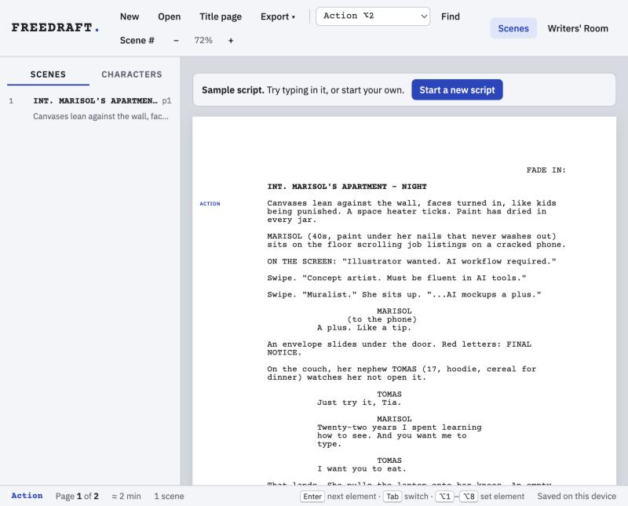

# FreeDraft

A free screenwriting app with an AI writers' room. It is one file: no install, no account, no subscription.

## Get it

- **Use it online:** https://lmvision-create.github.io/freedraft/
- **Download it:** [FreeDraft.html](https://github.com/lmvision-create/freedraft/releases/latest/download/FreeDraft.html). Double-click the file to open it in your browser. It works offline except for the AI features.

## What it does

**Writes like the screenwriting software you already know**
- Industry formatting: scene headings, action, character, parenthetical, dialogue, transitions, shots
- `Enter` moves to the next element, `Tab` switches element, `Option+1` to `Option+8` sets one directly
- SmartType: type `int.` and it suggests your locations, then `DAY` / `NIGHT`, and it fills in character names
- Automatic `(CONT'D)`, real US Letter pages (about one page per minute) and no character names stranded at the bottom of a page
- Scene and character navigator, scene numbers, find and replace, undo, title page

**Opens and saves your files**
- Opens and saves Final Draft `.fdx` files
- Opens and saves Fountain (`.fountain`) for Highland, WriterDuet and others
- Exports industry-format PDFs
- Your script autosaves in your browser. Export a file to back it up or move it to another computer.

**Writers' Room (AI)**
- **Punch up** a scene or selection
- **Alt lines:** six different takes on a line of dialogue
- **What's next:** writes the next half page
- **Format text:** turns notes or prose into screenplay format
- **Breakdown:** cast, props, wardrobe and locations for a scene
- **Coverage:** reader notes on the whole script
- **Ask** the room anything about your scene

The Writers' Room runs on Claude. Add your own [Anthropic API key](https://console.anthropic.com/settings/keys) under **Writers' Room → Add API key**. The key is stored only in your browser and sent only to Anthropic. Everything else works without a key.

## Keyboard

| Keys | Does |
|---|---|
| `Enter` | Next element |
| `Tab` / `Shift+Tab` | Switch element |
| `Option+1` to `Option+8` | Scene heading, action, character, parenthetical, dialogue, transition, shot, general |
| `Ctrl/Cmd+F` | Find and replace |
| `Ctrl/Cmd+P` | Export PDF |
| `Ctrl/Cmd+Z` | Undo |

## For developers

`freedraft.html` is the app. `./build.sh` wraps it into the standalone `index.html`. There's no build step beyond that and no dependencies to install. jsPDF, JSZip and the Anthropic SDK load from public CDNs.

FreeDraft is an independent project and isn't affiliated with Final Draft or Cast & Crew. It's licensed under [MIT](LICENSE).
